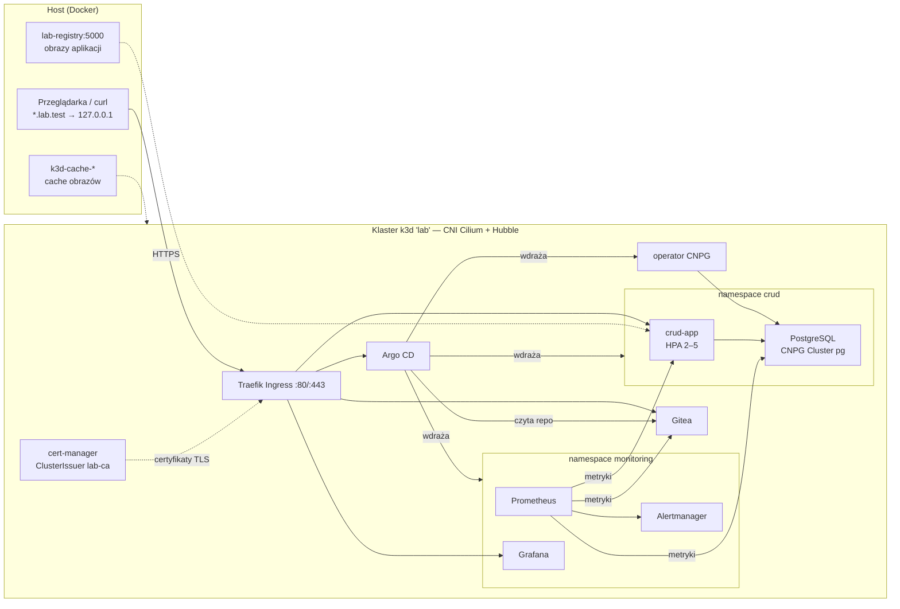

# k3d-gitops-lab

Lab Kubernetes CI/CD — k3d + Cilium + GitOps.

Lokalne środowisko Kubernetes na jednym komputerze. Jedno polecenie stawia klaster (k3d + Cilium),
własne CA, Gitea, Argo CD, a Argo CD wdraża z repozytorium resztę: PostgreSQL (CloudNativePG),
aplikację CRUD z autoskalowaniem i monitoring (Prometheus, Grafana, Alertmanager).

- [Wymagania](#wymagania)
- [Instalacja](#instalacja)
- [Dostęp do usług](#dostęp-do-usług)
- [Codzienna praca](#codzienna-praca)
- [Wprowadzanie zmian (GitOps)](#wprowadzanie-zmian-gitops)
- [Odinstalowanie](#odinstalowanie)
- [Struktura repozytorium](#struktura-repozytorium)
- [Architektura](#architektura)
- [Weryfikacja i testy](#weryfikacja-i-testy)
- [Rozwiązywanie problemów](#rozwiązywanie-problemów)
- [Decyzje projektowe](#decyzje-projektowe)
- [Wersje komponentów](#wersje-komponentów)

## Wymagania

| | |
|---|---|
| System | Linux (testowane: Ubuntu 24.04), x86_64 lub arm64 |
| Pamięć | 16 GB RAM (lab zużywa ~3–4 GB, pody mają limity) |
| Dysk | ~10 GB wolnego miejsca (obrazy, wolumeny) |
| Oprogramowanie | Docker (użytkownik w grupie `docker`), `kubectl`, `helm`, `git`, `python3` + `python3-venv`, `make`, `curl` |
| Opcjonalnie | `libnss3-tools` (`certutil`) — automatyczne zaufanie do CA w Firefoksie/Chrome |
| Uprawnienia | hasło `sudo` (tylko `/etc/hosts` i systemowy magazyn CA) |
| Porty | wolne `80`, `443`, `5000` na hoście |

`k3d` i Cilium CLI skrypt [k8s-lab.sh](k8s-lab.sh) doinstaluje sam, jeśli ich brakuje.

## Instalacja

```bash
git clone <adres-tego-repozytorium> k3d-gitops-lab && cd k3d-gitops-lab
make deps       # Ansible w lokalnym venv (.venv) + kolekcja kubernetes.core
make install    # cały stos; pyta o hasło sudo ("BECOME password")
```

`BECOME password` to hasło Twojego konta w systemie (to samo co przy `sudo`).
Bez uprawnień sudo: `cd ansible && ../.venv/bin/ansible-playbook site.yml -e manage_host=false`.
Wtedy wpisy z [Dostęp do usług](#dostęp-do-usług) trzeba dodać do `/etc/hosts` samodzielnie.

Co robi `make install` ([ansible/site.yml](ansible/site.yml)), po kolei:

| Etap (tag) | Co się dzieje |
|---|---|
| `cluster` | klaster k3d (1 server + 2 agenty) z Cilium/Hubble, rejestr obrazów, cache obrazów |
| `cert-manager` | cert-manager + własne CA (`ClusterIssuer lab-ca`), eksport `lab-ca.crt` |
| `host` | `*.lab.test` w `/etc/hosts`, CA w systemie i w przeglądarkach (sudo) |
| `gitea` | Gitea, repozytorium `gitea-admin/k3d-gitops-lab`, wypchnięcie tego repo, token dla Argo CD |
| `image` | budowa obrazu aplikacji i wypchnięcie do lokalnego rejestru |
| `argocd` | Argo CD + root Application → Argo CD wdraża wszystko z [gitops/](gitops/) |
| `wait` | czekanie, aż wszystkie aplikacje Argo CD będą `Synced/Healthy` |

Playbook jest idempotentny, więc można go uruchamiać wielokrotnie. Pojedyncze etapy uruchomisz tagiem, np.
`cd ansible && ../.venv/bin/ansible-playbook site.yml -t gitea`.

**Czas trwania.** Pierwsza instalacja pobiera ~1,5 GB obrazów. Przy szybkim łączu trwa to ~10–15 minut, przy wolnym znacznie dłużej.
Obrazy trafiają do lokalnego cache (`k3d-cache-*`), który przetrwa usunięcie klastra, więc ponowna instalacja
pobiera już tylko to, czego brakuje.

## Dostęp do usług

| Adres | Usługa | Login |
|---|---|---|
| https://crud.lab.test/items | aplikacja CRUD (REST) | — |
| https://argocd.lab.test | Argo CD | `admin` |
| https://gitea.lab.test | Gitea (repo `gitea-admin/k3d-gitops-lab`) | `gitea-admin` |
| https://grafana.lab.test | Grafana (folder **Lab** → „CRUD — aplikacja, baza, HPA”) | `admin` |

Hasła wypisuje `make passwords`. Są generowane przy pierwszej instalacji i trzymane w `.secrets/` (poza gitem).
Prometheus i Alertmanager nie mają Ingressu. Dostęp do nich przez port-forward:

```bash
kubectl -n monitoring port-forward svc/kps-prometheus 9090    # http://localhost:9090
kubectl -n monitoring port-forward svc/kps-alertmanager 9093  # http://localhost:9093
cilium hubble ui                                              # podgląd ruchu sieciowego (Hubble)
```

API aplikacji: `GET/POST /items`, `GET/PUT/DELETE /items/<id>`, `GET /healthz`, `GET /readyz`, `GET /metrics`.

## Codzienna praca

```bash
make stop       # koniec pracy: zatrzymuje klaster (dane, obrazy i konfiguracja zostają)
make up         # wznowienie pracy: uruchamia klaster i przywraca BPF dla Cilium
make status     # węzły, Cilium, aplikacje Argo CD, pody z problemami
make passwords  # adresy i hasła
```

`make up` działa także po restarcie komputera. Docker sam podnosi węzły, ale Cilium potrzebuje ponownego
zamontowania BPF, co `up` wykrywa i naprawia. Po `make up` daj klastrowi 1–2 minuty, zanim wszystkie aplikacje będą gotowe
(`make status`).

Wszystkie komendy `make` to skróty. Pełna lista: `make help`. Te same operacje na niższym poziomie:
`./k8s-lab.sh {install|up|bpf|upgrade|stop|status|destroy|purge-cache}`.

## Wprowadzanie zmian (GitOps)

Klastrem zarządza Argo CD na podstawie repozytorium w Gitei. Lokalne repozytorium jest źródłem prawdy,
a Gitea jego kopią, z której czyta Argo CD. **Zmian nie wprowadza się `kubectl apply`.** Argo CD i tak by je cofnął (self-heal).

**Zmiana konfiguracji** (manifesty, values, alerty, dashboardy w [gitops/](gitops/)):

```bash
git commit -am "Opis zmiany"
make push       # Argo CD wdraża zmianę w ciągu ~1 minuty (podgląd: https://argocd.lab.test)
```

**Nowa wersja aplikacji** ([src/crud-app/](src/crud-app/)):

```bash
# 1. zmiana kodu w src/crud-app/
# 2. podbicie taga obrazu w gitops/crud/manifests/deployment.yaml (np. 0.1.2 -> 0.1.3)
make image      # buduje i wypycha obraz o tagu z manifestu
git commit -am "crud-app 0.1.3: ..."
make push
```

**Nowy komponent:** utwórz katalog `gitops/<nazwa>/` z plikiem `application.yaml` (wzór: dowolny istniejący).
Root Application wykrywa go automatycznie.

**Zmiana bootstrapu** ([bootstrap/](bootstrap/), [cluster/](cluster/)): te elementy instaluje Ansible, nie Argo CD,
więc po zmianie trzeba ponownie uruchomić `make install`. Dla Cilium wystarczy `./k8s-lab.sh upgrade`.

## Odinstalowanie

```bash
make uninstall  # usuwa klaster + wpisy w /etc/hosts + zaufanie do CA (system i przeglądarki)
make purge      # jak wyżej + usuwa cache obrazów i .secrets/ (hasła, klucz CA)
```

`make uninstall` celowo zostawia cache obrazów i `.secrets/`. Ponowna instalacja jest wtedy szybka, a hasła i CA
pozostają te same (przeglądarka nie musi znowu ufać nowemu certyfikatowi). Po `make purge` na dysku nie zostaje nic
poza tym repozytorium (i katalogiem `.venv`, który można usunąć ręcznie).

Samo usunięcie klastra bez zmian w systemie: `./k8s-lab.sh destroy`.

## Struktura repozytorium

Katalogi odpowiadają kolejności instalacji: najpierw klaster, potem bootstrap, potem GitOps.

```
k3d-gitops-lab/
├── Makefile                    skróty: make help
├── k8s-lab.sh                  klaster k3d + Cilium + rejestr + cache obrazów (install/up/stop/status/...)
│
├── cluster/                    0. konfiguracja klastra (poza Kubernetesem), czyta k8s-lab.sh
│   ├── cilium-values.yaml        values Cilium/Hubble (z metrykami)
│   └── k3d-registries.yaml       mirrory obrazów → lokalne cache k3d-cache-*
│
├── bootstrap/                  1. instalowane przez Ansible PRZED Argo CD (Helm)
│   ├── cert-manager/             values + lab-ca.yaml (selfSigned → CA → ClusterIssuer lab-ca)
│   ├── gitea/                    values (SQLite, bez postgresql-ha/valkey)
│   └── argocd/                   values + root-app.yaml (app-of-apps → gitops/*/application.yaml)
│
├── gitops/                     2. wdraża Argo CD; 1 katalog = 1 Application
│   ├── cnpg-operator/            application.yaml + values.yaml   (operator CloudNativePG)
│   ├── postgres/                 application.yaml + manifests/    (CNPG Cluster, zapytania eksportera)
│   ├── crud/                     application.yaml + manifests/    (Deployment, Service, Ingress, HPA, ConfigMap)
│   ├── kube-prometheus-stack/    application.yaml + values.yaml   (Prometheus, Grafana, Alertmanager)
│   └── monitoring-config/        application.yaml + manifests/    (ServiceMonitory, PodMonitory, alerty, dashboardy)
│
├── src/crud-app/               kod aplikacji (Flask) + Dockerfile
├── tests/                      test autoskalowania: hpa-test.sh + obciążenie k6 (make test-hpa)
│
└── ansible/                    instalacja jednym poleceniem
    ├── site.yml                  instalacja (make install)
    ├── uninstall.yml             odinstalowanie (make uninstall / make purge)
    ├── group_vars/all.yml        wersje chartów bootstrapu, domeny, ścieżki
    └── tasks/01-…07-*.yml        etapy w kolejności wykonania
```

Pliki lokalne poza gitem: `.secrets/` (hasła, token Argo CD, klucz CA), `lab-ca.crt`, `.venv/`.

## Architektura



## Weryfikacja i testy

```bash
make status                       # wszystkie aplikacje Synced/Healthy, brak podów z problemami
make test-crud                    # dodanie i odczyt rekordu przez HTTPS

# trwałość danych: rekordy przetrwają usunięcie poda bazy
kubectl -n crud delete pod pg-1 && kubectl -n crud wait pod/pg-1 --for=condition=Ready --timeout=180s
curl -s https://crud.lab.test/items

# autoskalowanie: repliki rosną do 5 pod obciążeniem i wracają do 2 po ~1–2 min
make test-hpa

# alert CrudAppDown w Alertmanagerze po ~2–3 min
kubectl -n crud scale deploy/crud-app --replicas=0
kubectl -n crud scale deploy/crud-app --replicas=2    # przywrócenie
```

Monitoring obejmuje: aplikację (`http_requests_total`, czasy odpowiedzi i zapytań do bazy), PostgreSQL (wbudowany
eksporter CNPG, w tym `cnpg_crud_items_total`), Gitea, cert-manager, Cilium/Hubble i komponenty Kubernetesa.
Alerty ([gitops/monitoring-config/manifests/alerts.yaml](gitops/monitoring-config/manifests/alerts.yaml)):
`CrudAppDown`, `CrudAppHigh5xxRate`, `CrudAppHpaAtMax`, `PostgresDown`.

## Rozwiązywanie problemów

| Objaw | Przyczyna i rozwiązanie |
|---|---|
| Po `k3d cluster start` lub restarcie komputera pody nie mają sieci, Cilium nie działa | Brak montowań BPF w węzłach → `make up` (lub `./k8s-lab.sh bpf`) |
| Pody długo w `ContainerCreating` / `PodInitializing`, a łącze stoi | Zawieszone pobieranie obrazu (np. po chwilowym zerwaniu połączenia). Restart cache: `docker restart k3d-cache-docker k3d-cache-quay k3d-cache-ghcr k3d-cache-k8s` |
| Przeglądarka ostrzega o certyfikacie | Zainstaluj `libnss3-tools`, uruchom `cd ansible && ../.venv/bin/ansible-playbook site.yml -K -t host` i zrestartuj przeglądarkę. Albo zaimportuj `lab-ca.crt` ręcznie jako zaufane CA |
| `*.lab.test` nie odpowiada | Brak wpisów w `/etc/hosts` → etap `host` (jak wyżej) |
| Playbook: „Duplicate become password prompt” / „Sorry, try again” | Błędne hasło sudo. Sprawdź `sudo -v` i uruchom ponownie |
| Aplikacja Argo CD `OutOfSync` / `Degraded` | Szczegóły w UI Argo CD (https://argocd.lab.test) albo `kubectl -n argocd describe application <nazwa>`. Argo CD ponawia synchronizację automatycznie |
| Zmiana w repo nie trafia do klastra | Czy jest zacommitowana i wypchnięta (`make push`)? Argo CD sprawdza repo co ~1 min |
| `docker push localhost:5000/...` nie działa | Klaster (z rejestrem) nie działa → `make up` |
| Port 80/443/5000 zajęty przy instalacji | Zatrzymaj usługę, która go używa, albo zmień `HTTP_PORT` / `HTTPS_PORT` / `REGISTRY_PORT` w `k8s-lab.sh` |
| Mało pamięci | `make status` + `kubectl top pod -A`. Kolejno: `AGENTS=1` w `k8s-lab.sh` (przy nowym klastrze), `kubectl -n kube-system scale deploy/hubble-ui --replicas=0`, niższe limity Prometheusa w [gitops/kube-prometheus-stack/values.yaml](gitops/kube-prometheus-stack/values.yaml) |

Przydatne polecenia diagnostyczne:

```bash
kubectl get pods -A | grep -vE 'Running|Completed'
kubectl -n <namespace> describe pod <pod>      # zdarzenia: pobieranie obrazu, probe, OOM
kubectl -n <namespace> logs <pod> [--previous]
cilium status
```

## Decyzje projektowe

- **Własne CA (cert-manager) zamiast Let's Encrypt.** Domeny `*.lab.test` nie są publiczne, więc ACME nie zadziała.
  Klucz CA jest zapisywany w `.secrets/` i przywracany po przebudowie klastra, dzięki czemu zaufanie w systemie i przeglądarce zostaje.
- **Brak Bitnami.** Używane są tylko oficjalne charty projektów: jetstack, gitea, argo, prometheus-community, cloudnative-pg.
- **PostgreSQL przez CloudNativePG.** Narzut to sam operator (zmierzone: ~7m CPU, ~32 MiB RAM). W zamian dostajemy
  generowane hasło (Secret `pg-app`), usługi `pg-rw/ro` i **wbudowany eksporter Prometheusa**. Zamiast pisać własny eksporter,
  dodatkowe metryki (np. liczba rekordów) definiuje ConfigMap z zapytaniami SQL.
- **Gitea z SQLite** i cache/sesjami w pamięci, bez postgresql-ha i valkey-cluster. To wystarcza dla jednego użytkownika i oszczędza ~1 GB RAM.
- **Argo CD czyta repo przez wewnętrzny adres HTTP Gitei** z tokenem tylko do odczytu, więc nie musi ufać własnemu CA.
- **App-of-apps z jednym katalogiem na komponent.** Root Application wybiera `gitops/*/application.yaml`, a values
  i manifesty leżą obok definicji aplikacji.
- **Deployment aplikacji bez pola `replicas`.** Liczbą replik steruje HPA, a Argo CD z self-heal nie walczy z nim.
- **Metryki Cilium/Hubble włączone w values od początku.** Scrapowanie zapewniają PodMonitory w GitOps, więc nie trzeba aktualizować
  Cilium po instalacji CRD Prometheusa.
- **k3s**: kube-scheduler, controller-manager, etcd i kube-proxy nie są osobnymi komponentami, więc ich monitoring jest wyłączony.
  node-exporter działa bez montowania `/` hosta (węzły k3d to kontenery).
- **Lokalny cache obrazów** (pull-through, `k3d-cache-*`): każdy obraz pobiera się z internetu raz, a nie osobno na każdy węzeł,
  i nie znika przy przebudowie klastra.
- **Budżet RAM**: limity na każdym workloadzie, retencja Prometheusa 2 dni / 1,5 GB, wyłączone dex, notifications
  i applicationset w Argo CD.

## Wersje komponentów

| Komponent | Wersja | Gdzie zmienić |
|---|---|---|
| k3s (k3d) | v1.35 (domyślna k3d 5.9) | `k8s-lab.sh` |
| Cilium | 1.20 (domyślna Cilium CLI) | [cluster/cilium-values.yaml](cluster/cilium-values.yaml) |
| cert-manager | chart v1.21.2 | [ansible/group_vars/all.yml](ansible/group_vars/all.yml) |
| Gitea | chart 12.7.0 (Gitea 1.27) | [ansible/group_vars/all.yml](ansible/group_vars/all.yml) |
| Argo CD | chart 10.10.2 (Argo CD 3.5) | [ansible/group_vars/all.yml](ansible/group_vars/all.yml) |
| CloudNativePG | chart 0.29.1 (operator 1.30) | [gitops/cnpg-operator/application.yaml](gitops/cnpg-operator/application.yaml) |
| PostgreSQL | 18.6 | [gitops/postgres/manifests/cluster.yaml](gitops/postgres/manifests/cluster.yaml) |
| kube-prometheus-stack | chart 92.3.0 | [gitops/kube-prometheus-stack/application.yaml](gitops/kube-prometheus-stack/application.yaml) |
| crud-app | 0.1.2 | [gitops/crud/manifests/deployment.yaml](gitops/crud/manifests/deployment.yaml) |
